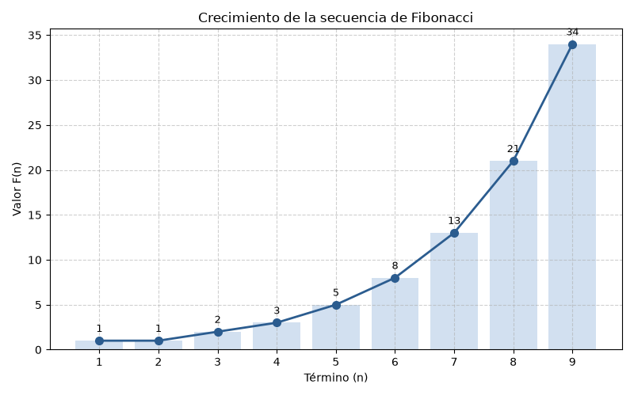

# Seminario-CST
Seminario de Prueba de CST en Github

## Secuencia y Espiral de Fibonacci (`Seminario_CST_fibonacci.py`)

Script en Python para calcular los primeros n términos de la secuencia de Fibonacci y visualizar tanto su crecimiento como su espiral geométrica mediante `matplotlib` y `numpy`. Solo se han representado 9 puntos, por lo que solo se observará el crecimiento y no se verá la expiral, para visualizar la expiral, tendremos que modificar el 9 por el valor que queramos.

## Instalación y ejecución

```bash
pip install -r requirements.txt
python Seminario_CST_fibonacci.py
```

## Visualización


